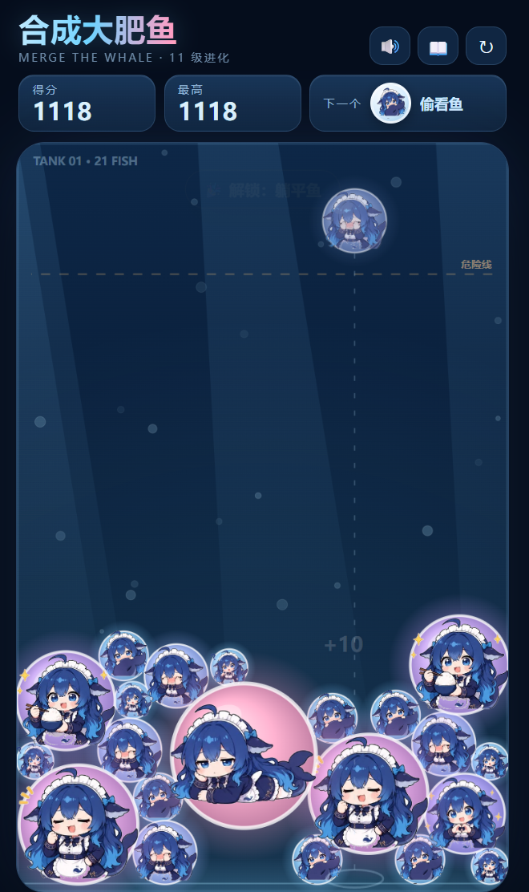
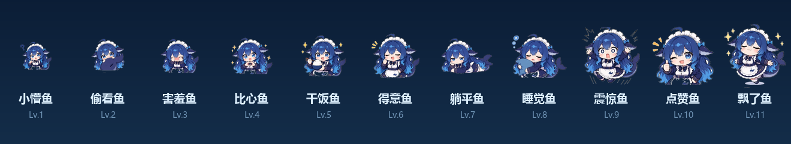

# 合成大肥鱼 · Merge the Whale

> 两只同款肥鱼碰一碰，她们就会进化。从一条「小懵鱼」开始，把 11 级大肥鱼养出来。

纯前端小游戏：Matter.js 物理 + Canvas 手绘 + WebAudio 合成音效，无框架、无构建、无后端。

**在线试玩：<https://jiangyonghan760.github.io/dafeiyu-merge/>**



## 玩法

- **移动鼠标 / 拖动手指**瞄准，**点击 / 松手**投放一条肥鱼
- 两条**同款**肥鱼撞在一起 → 进化成下一级，加分
- 短时间连续进化触发**连击**，最高 2.8 倍分数
- 两条 **Lv.11「飘了鱼」** 相撞 → **双鱼飞升**，直接 +260 起
- 鱼堆越过顶部**危险线**超过 1.2 秒 → 鱼塘满了，本局结束
- 手机可直接玩；键盘：`←` `→` 移动，`空格` 投放，`R` 重开，`M` 静音

## 进化链



| 等级 | 名字 | 口头禅 |
| --- | --- | --- |
| Lv.1 | 小懵鱼 | ？ |
| Lv.2 | 偷看鱼 | 盯—— |
| Lv.3 | 害羞鱼 | …别看我 |
| Lv.4 | 比心鱼 | 给你比个心 |
| Lv.5 | 干饭鱼 | 先干饭！ |
| Lv.6 | 得意鱼 | 嘿嘿嘿 |
| Lv.7 | 躺平鱼 | 摆了 |
| Lv.8 | 睡觉鱼 | 呼…呼… |
| Lv.9 | 震惊鱼 | 啊？？ |
| Lv.10 | 点赞鱼 | 这条鱼值得 |
| Lv.11 | 飘了鱼 | 我已经飘了 |

## 做了什么

- **物理**：Matter.js 圆形刚体 + 静态鱼缸；碰撞事件触发同级合成，合成后体积、质量、分数一起升级
- **渲染**：全部用 Canvas 2D 程序化绘制——鱼缸渐变、光柱、气泡、危险线、合成光环、粒子、飘分；肥鱼贴纸是表情包去白底后的 WebP
- **手感**：330ms 投放冷却、幽灵预览 + 垂直落点参考线、合成弹跳缩放、屏幕轻微震动、连击飘字
- **音效**：WebAudio 实时合成（投放、随等级升调的合成音、飞升琶音、结束音），无音频文件
- **进度**：最高分、已解锁图鉴、静音状态存 localStorage；图鉴里没解锁的鱼是剪影
- **响应式**：按可用高度算画布尺寸，手机竖屏一屏放下

## 本地运行

```bash
git clone https://github.com/jiangyonghan760/dafeiyu-merge.git
cd dafeiyu-merge
python -m http.server 8123
# 浏览器打开 http://127.0.0.1:8123
```

也可以直接双击 `index.html`（纯静态，无跨域请求）。

## 目录结构

```text
index.html            # 页面骨架
css/style.css         # 布局与 UI 样式
js/game.js            # 游戏逻辑：物理、合成、计分、特效、音效
js/matter.min.js      # Matter.js 0.20.0（MIT）
assets/fish-01.webp   # 11 级肥鱼贴纸（去白底）
assets/manifest.json  # 等级 / 名字 / 主色 / 半径
tools/build_assets.py # 表情包 → 贴图 的一键处理脚本
docs/                 # README 截图
```

## 素材与许可

- 肥鱼形象来自本地 **dsh-meme** 插件内置的「大肥鱼」图库（DeepSeek 鲸鱼娘 chibi 同人，共 24 张，本作选用 11 张）。
- 形象版权归原作者 / 权利方所有，**本项目仅作个人娱乐与非商业展示**；如需商用请自行取得授权。
- `tools/build_assets.py` 记录了自动去白底 → 裁切 → 导出 WebP 的完整流程，方便替换成你自己的贴纸。
- 代码以 MIT 协议开源（见 [LICENSE](LICENSE)），不含图片素材授权。
